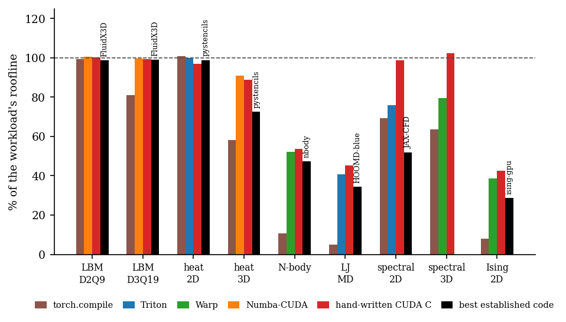

# pyhpc-overview

**Nine GPU workloads from six Python packages, each measured against a roofline on the same GPU,
against hand-written CUDA C and against established codes.**



This repository holds no simulation code. It collects the final results of the six packages of
the Python-HPC suite and turns them into one figure, one table and a short paper
([paper/paper.pdf](paper/paper.pdf)).

| package | workload | established codes run on the same GPU |
|---|---|---|
| [pylbm](https://github.com/walidhemati/pylbm) | lattice Boltzmann D2Q9 / D3Q19 | FluidX3D, Lettuce |
| [pyheat3d](https://github.com/walidhemati/pyheat3d) | heat / Jacobi stencils 2D / 3D | pystencils, AN5D |
| [pygravity](https://github.com/walidhemati/pygravity) | direct-summation N-body | CUDA Samples nbody |
| [pymd](https://github.com/walidhemati/pymd) | Lennard-Jones MD | LAMMPS (GPU, KOKKOS), HOOMD-blue |
| [pyspectral](https://github.com/walidhemati/pyspectral) | pseudo-spectral Navier-Stokes 2D / 3D | JAX-CFD, spectralDNS, Dedalus |
| [pyising](https://github.com/walidhemati/pyising) | Ising Monte Carlo | NVIDIA ising-gpu |

## Reproduce

The six packages must be checked out next to this repository (`../pylbm`, ...) with their final
`results/rtx3070-laptop.json` and `results/counterparts.json`.

```bash
python collect.py                 # -> results/summary.json (nothing is re-measured)
python figures/make_figures.py    # -> figures/efficiency.{pdf,png}, paper/results.tex
cd paper && tectonic paper.tex
```

MIT licence, Copyright (c) 2026 Walid Hemati.
